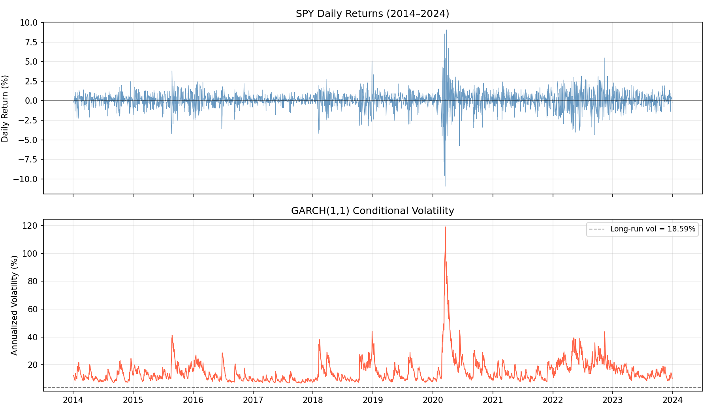
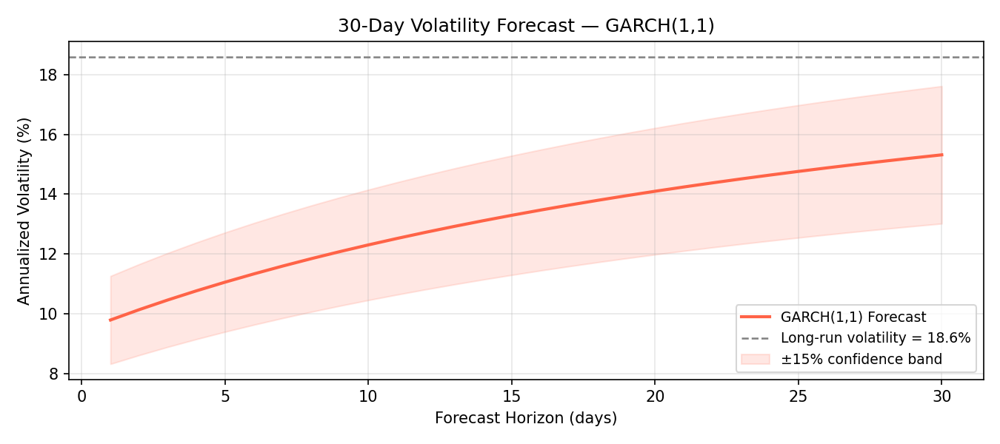
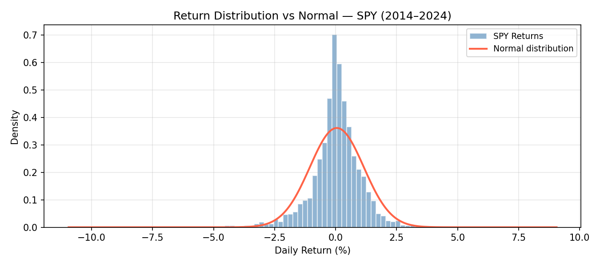

# GARCH(1,1) Volatility Modeling

> Conditional volatility estimation and short-term forecasting on S&P 500 using GARCH(1,1).

---

## Overview

For my third quantitative finance project, I implemented a GARCH(1,1) model from scratch to capture the dynamic nature of financial volatility. Unlike Black-Scholes which assumes constant volatility, GARCH models two well-documented empirical features of financial returns: **volatility clustering** (turbulent periods tend to follow turbulent periods) and **mean reversion** (volatility always reverts to its long-run average).

The model is estimated on 10 years of daily SPY returns (2014–2024) via maximum likelihood, then used to forecast annualized volatility over a 30-day horizon.

---

## Theory

### Why Constant Volatility Fails

Financial returns exhibit **fat tails** and **volatility clustering** — both inconsistent with the constant-σ assumption of Black-Scholes. The March 2020 crash sent SPY volatility above 120% annualized for several weeks, a regime impossible to capture with a fixed parameter.

### The GARCH(1,1) Model

Returns are modeled as :

$$r_t = \mu + \varepsilon_t, \qquad \varepsilon_t = \sigma_t z_t, \qquad z_t \sim \mathcal{N}(0,1)$$

The conditional variance evolves according to :

$$\sigma_t^2 = \omega + \alpha \cdot \varepsilon_{t-1}^2 + \beta \cdot \sigma_{t-1}^2$$

| Parameter | Role |
|-----------|------|
| **ω** (omega) | Long-run variance floor |
| **α** (alpha) | Reactivity to recent shocks — weight on $\varepsilon_{t-1}^2$ |
| **β** (beta) | Persistence of past volatility — weight on $\sigma_{t-1}^2$ |

Stationarity requires **α + β < 1**. The unconditional (long-run) volatility is :

$$\sigma_{LT} = \sqrt{\frac{\omega}{1 - \alpha - \beta}}$$

### Mean Reversion

The h-step-ahead variance forecast converges to the long-run variance :

$$\sigma_{t+h}^2 \xrightarrow{h \to \infty} \sigma_{LT}^2$$

The speed of convergence is governed by $(\alpha + \beta)^h$ — the closer to 1, the slower the reversion.

---

## Results

Estimated on **SPY daily returns, 2014–2024** (2,515 observations).

### Estimated Parameters

| Parameter | Value | Interpretation |
|-----------|-------|----------------|
| **ω** | 0.0378 | Long-run variance floor |
| **α** | 0.2020 | Strong reactivity to shocks |
| **β** | 0.7704 | High persistence |
| **α + β** | 0.9725 | Near-integrated — slow mean reversion |
| **σ_LT** | **18.59%/year** | Long-run annualized volatility |
| Log-likelihood | −3171.79 | Model fit |
| AIC | 6351.57 | Information criterion |

The high α + β = 0.97 is typical of equity indices — volatility shocks are very persistent, consistent with observed prolonged stress periods (2018, 2020, 2022).

### 10-Day Volatility Forecast

| Day | Vol/day (%) | Vol/year (%) |
|-----|-------------|--------------|
| 1 | 0.617 | 9.79 |
| 3 | 0.659 | 10.46 |
| 5 | 0.697 | 11.06 |
| 10 | 0.775 | 12.31 |
| → ∞ | 1.171 | 18.59 |

The forecast starts at 9.79%/year (current low-vol regime) and slowly converges toward the long-run level of 18.59%.

### Visualizations


*Top: SPY daily returns. Bottom: GARCH(1,1) conditional volatility — the COVID crash (March 2020) spikes to 120% annualized, illustrating volatility clustering.*


*30-day ahead volatility forecast with ±15% confidence band. Mean reversion toward 18.6% is clearly visible.*


*SPY return distribution vs fitted normal — fat tails and excess kurtosis justify the use of a time-varying volatility model.*

---

## Project Structure

```
garch-volatility/
├── garch.py        # Data download, GARCH(1,1) estimation, parameter display
├── forecast.py     # Multi-step volatility forecasting
├── plots.py        # Conditional volatility, forecast, return distribution
└── main.py         # Entry point — prints parameters and 10-day forecast
```

---

## Usage

```bash
# Install dependencies
pip install numpy arch matplotlib yfinance

# Run estimation and forecast
python main.py

# Generate visualizations
python plots.py
```

---

## References

- Engle, R. (1982). *Autoregressive Conditional Heteroscedasticity with Estimates of the Variance of United Kingdom Inflation*. Econometrica.
- Bollerslev, T. (1986). *Generalized Autoregressive Conditional Heteroskedasticity*. Journal of Econometrics.
- Hull, J. (2022). *Options, Futures, and Other Derivatives* (11th ed.). Pearson.